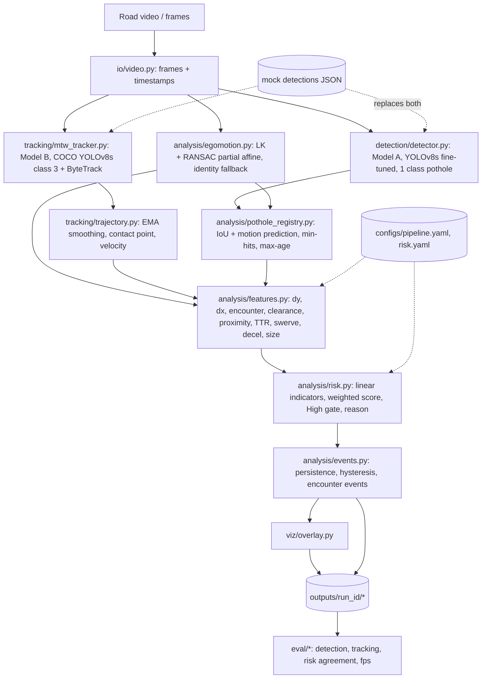

# Architecture

Scope (from the project PPT): potholes + motorized two-wheelers (MTW), **offline** video analysis, explainable Low / Moderate / High
**potential-risk** indication. Out of scope: GPS, backend, dashboard, audio alerts, edge hardware, cyclists, pedestrians.

## Data flow

Two detectors, never one merged model: pothole datasets label only potholes and vehicle datasets only vehicles, so a merged
model would learn to suppress its own targets (Blueprint v1, section 1.3).

## Modules (src/ptr)
| module | responsibility |
|---|---|
| `config.py` | strict typed YAML loading; **no defaults in code**, missing/unknown keys are errors; `RiskConfig.for_mode()` picks the moving/static block and normalises weights |
| `schemas.py` | `Detection`, `Track`, `PotholeObs`, `InteractionFeatures`, `RiskAssessment`, `Event` (modules exchange these, not raw arrays) |
| `logging_setup.py`, `utils.py` | per-run logging with run id; seeding, CSV helpers |
| `io/video.py` | probe, frame iterator (stride, resize, timestamps), writer |
| `detection/detector.py` | pothole detector wrapper; `MockDetections`; lazy Ultralytics import |
| `tracking/mtw_tracker.py` | `model.track(..., persist=True, tracker=<yaml>, classes=[3])` |
| `tracking/trajectory.py` | per-id history, EMA box smoothing, contact point, velocity/heading, pruning, reliability flag |
| `analysis/geometry.py` | the sign conventions (single source of truth), IoU, box mapping |
| `analysis/pothole_registry.py` | short-term pothole stabiliser (not a map in moving mode) |
| `analysis/egomotion.py` | frame-to-frame global motion + bounded composition (`EgoHistory`) |
| `analysis/features.py` | per-pair interaction features over a sliding window |
| `analysis/risk.py`, `analysis/events.py` | scoring and encounter events |
| `analysis/rescore.py` | re-run risk + events from `interactions.csv` (sensitivity analysis) |
| `viz/overlay.py` | boxes, trails, risk panel, legend, ego indicator |
| `eval/*` | detection (P/R/F1/AP, curves, gallery), tracking (motmetrics), risk agreement, fps |
| `pipeline.py` | orchestration and output writing |
| `dataprep.py` | VOC/YOLO conversion, cleaning, hashing, splits, Test B import, annotator agreement |
| `synthetic.py` | synthetic pinhole scenes for the tests and `make_synthetic_video.py` |

(`dataprep.py`, `utils.py`, `analysis/rescore.py` and `synthetic.py` were added to the requested layout to avoid duplicated logic.)

## Run outputs: `outputs/<run_id>/`
| file | content |
|---|---|
| `annotated.mp4` | overlay video (codec `mp4v`; re-encode with ffmpeg for browsers, see README) |
| `tracks.csv` | one row per MTW per processed frame: raw box, smoothed box, contact point, velocity, heading, age, reliability |
| `potholes.csv` | registry output per frame: box, confidence, confirmed, last_known, size class |
| `interactions.csv` | one row per (MTW, pothole) pair and frame: all features, validity flags, indicator scores, total, raw and accepted label, reason |
| `events.csv` | one row per encounter: peak class, peak score, reason, clearance, direction, indicator scores at the peak, clip id |
| `egomotion.csv` | per frame: valid flag, failure reason, inlier ratio, translation, rotation, scale |
| `summary.json` | counts, camera mode, fps, ego validity fraction, unreliable tracks, measured wall time |
| `config_used.yaml` | both configs actually used + run metadata |
| `run.log` | log with the run id |

`frame` columns are **processed-frame indices** (original index = `frame * frame_stride`); times `t` are in seconds of the original video.
